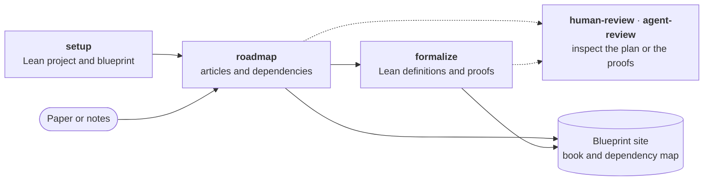

<h1 align="center"><br>AutoformBot</h1>

<p align="center">
  <strong>Turn a paper or your notes into a Lean 4 formalization you can check.</strong><br>
  A plugin for your coding assistant: Claude Code, Muse Code or Codex.
</p>

<p align="center">
  <a href="#what-you-get">What you get</a> · <a href="#installation">Installation</a> ·
  <a href="#quick-start">Quick start</a> · <a href="skills/setup/assets/cabannes-thesis-project/README.md">Example</a>
</p>

## What you get

Point AutoformBot at a paper, a book chapter or your notes. It plans the formalization, has agents carry it out in Lean,
and shows exactly what is proved. See the [example project](skills/setup/assets/cabannes-thesis-project/README.md).



- **A plan tied to the source.** The roadmap gives each definition and result its own Markdown article, citing the
  passage it comes from and linking what it depends on. A coverage page records what is in scope and what is not.
- **Many agents at once.** The dependency graph splits the work into pull-request-sized steps, and agents take every
  step whose prerequisites are done. Each checks Mathlib and the libraries you depend on before writing a new lemma.
- **Proofs Lean has checked.** A result counts as proved only when it builds with no `sorry` or new axiom, and a
  separate review agent has found its statement faithful to the source. Progress is recomputed on every run, and
  the CI written by `setup` replays the project's declarations through the Lean kernel on every pull request,
  failing on a `sorry` outside statements you left open or on a nonstandard axiom.
- **Statement review without reading Lean.** Lean checks proofs, not whether a theorem says what the paper says. To
  approve each statement yourself, turn on statement review with `human-review`: an agent that sees only the Lean
  writes the statement back in plain English, and you compare it with the source.
- **Everything in your repository.** The blueprint is Markdown in Git beside the Lean code; no service holds it.
  AutoformBot creates no remote and pushes nothing unless you ask.
- **A site to share.** On request, the blueprint becomes a public website on GitHub Pages: the mathematics as a
  readable book beside its dependency map, with search, progress figures and a Lean link on each statement.

## Installation

Requires Python 3.10+, [`uv`](https://docs.astral.sh/uv/), Git, and Lean 4 v4.27.0 or newer with Lake.

**Claude Code**

```bash
claude plugin marketplace add facebookresearch/autoform-bot@v0.6.0
claude plugin install autoform@autoform
```

**Muse Code**

```bash
muse plugins marketplace add autoform 'https://github.com/facebookresearch/autoform-bot.git#v0.6.0'
muse plugins install autoform@autoform
```

**Codex**

```bash
codex plugin marketplace add facebookresearch/autoform-bot --ref v0.6.0
codex plugin add autoform@autoform
```

These commands install release 0.6.0. Then start a new session in your project, or anywhere for a new project.

<details>
<summary>Other install options</summary>

- **On Claude Code before 2.1.71**, run `claude plugin marketplace add 'facebookresearch/autoform-bot#v0.6.0'` instead.
- **To follow `main`**, drop the `@v0.6.0` or `#v0.6.0` suffix, and give Codex `--ref main`.
- **To move from `main` onto the release**, remove the `autoform` marketplace, then run the commands above.
  Claude Code: `claude plugin marketplace remove autoform`. Codex: `codex plugin marketplace remove autoform`.
  Muse Code: `muse plugins remove autoform`, then `muse plugins marketplace remove autoform`.

</details>

## Quick start

Type these into your coding assistant; it runs AutoformBot's CLI for you.

| Step | Claude Code, Muse Code | Codex | What it does |
| :-: | --- | --- | --- |
| 1 | `/autoform:setup` | `$autoform:setup` | Set up the Lean project and blueprint |
| 2 | `/autoform:roadmap` | `$autoform:roadmap` | Plan from a paper or notes |
| 3 | `/autoform:formalize` | `$autoform:formalize` | Write Lean definitions and proofs |
| Any time | `/autoform:human-review` | `$autoform:human-review` | Review the roadmap, progress and statements |
| Any time | `/autoform:agent-review` | `$autoform:agent-review` | Request an independent AI review |

For example, invoke `roadmap` and ask: "Build a complete roadmap for Sections 2–4 of `paper.pdf`." Keep the source
in your project, or give a path the agent can read.

## Run several sessions

One session runs only so many agents at once, so for a large project, run several sessions. In Codex, one session may
be enough once you raise `max_threads` under `[agents]` in `~/.codex/config.toml`. Sessions divide the work by
claiming roadmap articles on a shared claim board, kept as Git refs on the project's `origin`.

1. Give each session its own clone of the project, with the same `origin` and the same branch (not a `git worktree`).
2. Tell each session that other sessions share the project, and let it push claims and verified results to
   `origin`. Do this even when they all start together: each one sees an empty claim board and would otherwise work
   without claims.

For example, invoke `formalize` in each session and ask: "Formalize the results that are ready. Four other sessions
share this project; use claims, and push claims and verified results to `origin`."

Sessions on one machine share its memory, and each builds Lean, so start only as many as fit. They also share one
Lean runtime, the process behind the plugin's Lean tools; [`servers/README.md`](servers/README.md) gives its limits.

## Development

Clone with `git clone https://github.com/facebookresearch/autoform-bot.git`, then follow
[CONTRIBUTING.md](CONTRIBUTING.md). The [blueprint format and CLI reference](autoform_cli/README.md),
[`servers/README.md`](servers/README.md) and the [changelog](CHANGELOG.md) cover the rest. MIT [license](LICENSE).

Issues and ideas are welcome. After a setup, roadmap or formalize run, your agent may end its report with a link to a
draft issue about where AutoformBot got in its way; you decide whether to send it. `AUTOFORM_DEBRIEF=0` turns this off.
