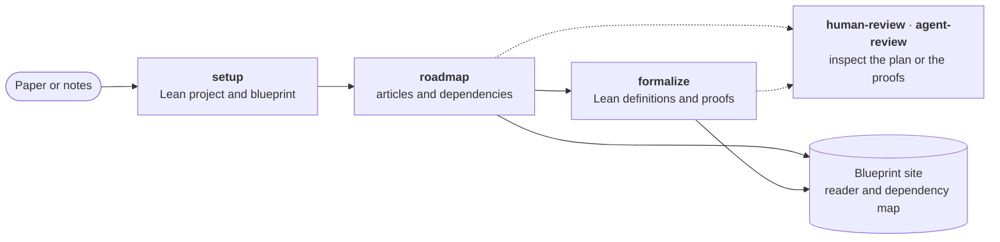

<h1 align="center"><br>AutoformBot</h1>

<p align="center">
  <strong>Turn mathematical papers and notes into Lean 4 formalizations, from your coding assistant.</strong><br>
  A plugin for Claude Code, Codex and Muse Code: plan the work, write the proofs, review the progress.
</p>

<p align="center">
  <a href="#installation">Installation</a> · <a href="#quick-start">Quick start</a> ·
  <a href="#run-several-sessions">Several sessions</a> · <a href="autoform_cli/README.md">CLI reference</a> ·
  <a href="CHANGELOG.md">Changelog</a>
</p>

## How it works



Autoform keeps the roadmap and dependency graph as Markdown under `blueprint/`. Its publication is one full-page
mathematical reader and dependency map with authored areas and global search; graphs and pages are derived. Browse
the [Cabannes thesis example](skills/setup/assets/cabannes-thesis-project/README.md), or read the
[blueprint format and CLI reference](autoform_cli/README.md).

## Installation

Requires Python 3.10+, [`uv`](https://docs.astral.sh/uv/), Git, and Lean 4 v4.27.0 or newer with Lake.

**Claude Code**

```bash
claude plugin marketplace add facebookresearch/autoform-bot@v0.6.0
claude plugin install autoform@autoform
```

**Codex**

```bash
codex plugin marketplace add facebookresearch/autoform-bot --ref v0.6.0
codex plugin add autoform@autoform
```

**Muse Code**

```bash
muse plugins marketplace add autoform 'https://github.com/facebookresearch/autoform-bot.git#v0.6.0'
muse plugins install autoform@autoform
```

These install release 0.6.0 ([changelog](CHANGELOG.md)). Then start a new session in the repository to set up.

<details>
<summary>Older Claude Code, moving onto the release, or following <code>main</code></summary>

- Claude Code before 2.1.71 takes `'facebookresearch/autoform-bot#v0.6.0'` instead of the `@v0.6.0` form, quoted
  for shells that read `#`.
- To move an install that follows `main` onto the release, remove the `autoform` marketplace first
  (`claude plugin marketplace remove autoform`, `codex plugin marketplace remove autoform`, or
  `muse plugins remove autoform` and then `muse plugins marketplace remove autoform`), then run the commands again.
- To follow `main` instead, drop the `@v0.6.0` or `#v0.6.0` suffix, and give Codex `--ref main`.

</details>

## Quick start

Run these skills from your agent window (in Muse Code, as commands of the same names); there is no CLI to learn.

| Step | Claude Code | Codex | What it does |
| :-: | --- | --- | --- |
| 1 | `/autoform:setup` | `$autoform:setup` | Set up the project |
| 2 | `/autoform:roadmap` | `$autoform:roadmap` | Plan from a paper or notes |
| 3 | `/autoform:formalize` | `$autoform:formalize` | Write Lean definitions and proofs |
| Any time | `/autoform:human-review` | `$autoform:human-review` | Review the roadmap and progress |
| Any time | `/autoform:agent-review` | `$autoform:agent-review` | Request an independent AI review |

> [!TIP]
> Invoke `roadmap` and ask: "Build a complete roadmap for Sections 2–4 of `paper.pdf`." Keep the source in your
> project, or give a path the agent can read.

> [!NOTE]
> Setup changes local files by default. Creating or pushing a remote repository, enabling GitHub Pages, and
> publishing blueprint content require an explicit request; content published through Pages is public.

Each Setup, Roadmap, and Formalize run includes a debrief, and a run that hit AutoformBot friction drafts an issue,
usually in `.git/autoform/`; `AUTOFORM_DEBRIEF=0` turns it off.

## Run several sessions

> [!TIP]
> Codex limits how many agents one session runs at once:
> raise `max_threads` under `[agents]` in `~/.codex/config.toml` before reaching for more sessions.

To put more agents on a large project than one session allows, run several sessions on it at once. They coordinate
through claims: temporary leases on roadmap articles, stored as Git refs on the project's `origin`, so no session
can take a leaf another one holds.

1. Give each session its own clone of the project, with the same `origin` and the same branch. Git checks out a
   branch in only one worktree at a time.
2. Tell each session that other sessions share the project, and allow it to push claims and verified results to
   `origin`. For example, invoke `formalize` and ask: "Formalize the ready frontier. Four other sessions are working
   on this project; use claims, and push claims and verified results to `origin`."

> [!IMPORTANT]
> Say so even when the sessions start together:
> each one sees an empty claim board and would otherwise work without claims.

Sessions on one machine share its memory, so start no more than it can build Lean for. They also share one Lean
runtime, which by default keeps four checkouts loaded and runs one REPL call per 32 GB of memory; raise its limits
as [`servers/README.md`](servers/README.md) describes.

## Development

Clone with `git clone https://github.com/facebookresearch/autoform-bot.git`, then follow
[CONTRIBUTING.md](CONTRIBUTING.md); [`servers/README.md`](servers/README.md) covers Lean servers.
AutoformBot is released under the [MIT license](LICENSE).
